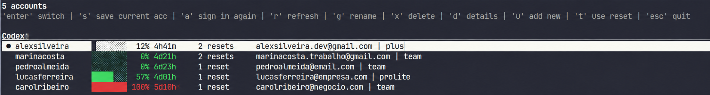

# Account Hub

Manage Codex and Claude Code accounts inside [Herdr](https://herdr.dev).
Switch accounts, check usage, and use available Codex resets from one picker.
Codex switching reloads open chats while preserving their history and titles.
Claude Code support is **beta**.



## Install

```sh
herdr plugin install C0R0NELL/herdr-account-hub
```

Requires Herdr, Python 3.11+, and the relevant agent CLI.
See the [guide](docs/guide.md) for compatibility and setup details.

## Use

Open Account Hub from Herdr's plugin manager. Save your current login or add
another account through the picker, then select the account you want to use.
Available controls are shown in the interface.

Configuration, private storage, and development instructions are in the
[guide](docs/guide.md). Authentication and reload investigations are kept in
[docs/solutions/](docs/solutions/).

Independent fork of [herdr-account-switch](https://github.com/rcosteira79/herdr-account-switch).
